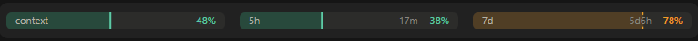

# tanmen の Claude Code mod

tanmen が作った Claude Code の mod（プラグイン）を配る marketplace。名前は `tanmen`。

Unofficial Claude Code mods by tanmen. This repository is a plugin marketplace named `tanmen`.

Anthropic の公式のものではありません。

## mod

| mod | 中身 |
| --- | --- |
| [usage-bars](plugins/usage-bars) | Claude Code Desktop の入力欄の上に context・5h・7d の使用率をバーで常時出す |
| [archive-check](plugins/archive-check) | Claude Code Desktop の入力欄の上に、このセッションをアーカイブしてよいか（Done / Check / Busy）を札で出し、押すと右側の枠に理由と操作を並べる |



## 入れ方

```sh
claude plugin install <mod> --marketplace tanmen/claude-tanmen-plugins
```

入った mod の id は `<mod>@tanmen`（例: `usage-bars@tanmen`）。設定や外し方は各 mod の README にある。

## License

MIT
