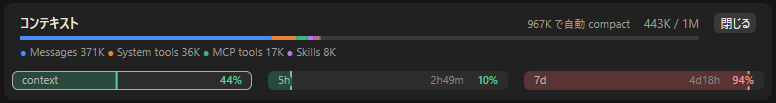
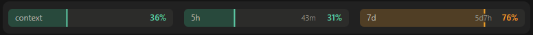

# Usage Bars for Claude Code

Claude Code Desktop（Code タブ）の入力欄の上に、context・5 時間・7 日の使用率を 3 本のバーで常に出す mod（Claude Code のプラグイン）。バーを押すと、context の内訳やリセットの日時を出す。

An unofficial Claude Code mod that keeps the context window, 5-hour and 7-day usage visible as three bars above the prompt in Claude Code Desktop. Press a bar for the context breakdown or the reset time.


Anthropic の公式のものではありません。

## 出すもの

| バー | 中身 |
| --- | --- |
| `context` | 今のセッションの context window の使用率 |
| `5h` | 5 時間の利用枠の使用率と、リセットまでの残り時間 |
| `7d` | 7 日の利用枠の使用率と、リセットまでの残り時間 |

- 色は 50% 未満が緑、50% 以上が黄、80% 以上が赤

## バーを押したとき

押したバーの詳細を、バーの上に開く。使用率はバーと重なるので出さない。

| バー | 出すもの |
| --- | --- |
| `context` | 使っている量と窓の大きさ、自動 compact が走る量、`/context` と同じ分け方の内訳（色分けした細いバーと、多い順に 4 つ。手元での見積もりで通信はしないので、`/context` の数字と少しずれることがある） |
| `5h` | 何時にリセットされるか（例: `今日 20:30 にリセット`） |
| `7d` | 何月何日の何時にリセットされるか（例: `10月18日（日）12:00 にリセット`） |



- 同じバーをもう一度押すか「閉じる」で閉じる。別のバーを押すと、そのバーの詳細に切り替わる
- 会話の上に浮かぶ popup にはできない（mod が描く場所はどれも決まった枠の中で、会話の上に重ねる場所は無い）ので、帯が上に伸びて出る

## 必要なもの

- Claude Code Desktop の Code タブ（手元で動くセッション）
- 5h / 7d を出すには、Claude のサブスクリプション（Pro / Max）でログインしていること。API キーで使っているときは 5h / 7d が `--` のままになる
- Claude Code 2.1.295（Windows 版 Desktop に同梱のもの）で確かめた。mod の API（function hooks）は early access で、版が上がると動かなくなることがある

## 入れ方

Desktop の Code タブでは `/plugin` が使えないので、ターミナルから入れる。どちらか一方でよい。

シェルから（スコープは既定の `user` で入る）:

```sh
claude plugin install usage-bars --marketplace tanmen/claude-tanmen-plugins
```

ターミナルで起動した Claude Code のプロンプトから:

```
/plugin install usage-bars --marketplace tanmen/claude-tanmen-plugins
```

こちらは `Add marketplace?` に `y`、スコープは `user` を選ぶ。

user スコープで入れると、Desktop の Code タブで手元に作るセッションにも読み込まれる。帯が出るのは**入れたあとに開いたセッションから**で、入れたときにもう開いていたセッションには出ない。

外すとき:

```sh
claude plugin uninstall usage-bars@tanmen
```

## 大きさ

設定項目 `size` で 2 通りから選べる。上のスクリーンショットが既定の `compact`、下が `regular`。

| `size` | バー | 帯の高さ |
| --- | --- | --- |
| `compact`（既定） | 19px・文字 11px | 40px（Desktop 自身の使用量の通知と同じ高さ） |
| `regular` | 26px・文字 12px | 47px |



帯の上下の余白（約 21px）は Desktop の枠のもので、mod からは変えられない。大きさで変わるのはバーの高さと文字の大きさだけ。

入れるときに選ぶ:

```sh
claude plugin install usage-bars --marketplace tanmen/claude-tanmen-plugins --config size=regular
```

入れたあとに変える（名前は `usage-bars@tanmen` の形で渡す。変えたあとは Claude Code を起動し直すと効く）:

```sh
echo '{"size":"regular"}' | claude plugin configure usage-bars@tanmen --values-stdin
```

## 知っておくこと

- **色はダークテーマ向け。** バーは SVG の画像として描かれ、アプリのテーマに追従しない。ライトテーマでは確かめていない
- **5h / 7d は 3 つの読み方のうち一番新しい値を出す。**
  - このセッションの応答が運んできた値（ターンが終わるたび）
  - 使用量 API の値（`/usage` と同じ口）。手元の値が 5 分より古いときに読む（セッションを開いた直後と、Desktop がそのセッションの帯を描いている間）。5h / 7d のバーを押したときは、1 分より古ければ読み直す
  - 別のセッションが記録した値（1 分ごとに取り込む。通信はしない）。別のセッションで使った分も、このセッションのターンを待たずに反映される
- **使用量 API は Claude Code のログイン情報で読む**（`https://api.anthropic.com/api/oauth/usage`）。資格情報は Claude Code が持ったままで、mod には渡らない。マシンの全セッションで読んだ値と読みに行った時刻を共有するので、読みに行くのはマシン全体でおおよそ 5 分に 1 回、多くても 1 分に 1 回ほどになる。`CLAUDE_CODE_DISABLE_NONESSENTIAL_TRAFFIC` を設定していると読まず、応答と別のセッションの値だけで出す
- **セッションを開いた直後**は、最後に記録した値を出す（記録はマシンの中で全セッション共通）。記録から 5 分以内ならそれを今の値として出し、API は読まない。それより古ければ灰色で出し、API を読めたら置き換える。context は最初の応答まで `--`
- **送信前の「新しいセッション」画面には出ない。** Desktop は最初のメッセージを送ってから Claude Code を起動するので、その前は mod が動いていない
- API キーや 3P プロバイダ・ゲートウェイで使っているときは 5h / 7d を出さず、記録した値も API も使わない。最初の応答が来ても 5h / 7d が空なら、灰色の値を消して `--` にする
- 残り時間の表示は 1 分ごとに描き直す
- ターミナルには出さない（ターミナルには `statusLine` がある）。アンケートが出ている間は、帯をアンケートに譲る

## 開発

```sh
claude plugin validate .
claude plugin test .
```

作業中の mod は `claude --plugin-dir .` で読み込める。

型チェック: `claude --plugin-dir .` で一度起動すると、Claude Code が `.claude-plugin/types/` に型定義と `tsconfig.json` を置く（インストールしたものや `claude -p` では置かれない）。ルートの `tsconfig.json` はそれを継いでいるので、そのあとは `tsc -p .` で検査できる。

## License

MIT
